# Блок-схемы СЕЙСМОС

Документ содержит блок-схемы системы контроля периметра **СЕЙСМОС** на
сейсмических геофонах GS-20DX. Схемы приведены в формате Mermaid и
отображаются на GitHub напрямую; готовые изображения лежат в `docs/img/`.

Содержание:

1. [Общая архитектура](#1-общая-архитектура)
2. [Поток данных](#2-поток-данных)
3. [Алгоритм обнаружения события](#3-алгоритм-обнаружения-события)
4. [Классификация и уровни](#4-классификация-и-уровни)
5. [Конечный автомат состояний системы](#5-конечный-автомат-состояний-системы)
6. [Жизненный цикл тревоги](#6-жизненный-цикл-тревоги)
7. [Схема развёртывания](#7-схема-развёртывания)
8. [Аппаратный сегмент и цепочка датчиков](#8-аппаратный-сегмент-и-цепочка-датчиков)

---

## 1. Общая архитектура

Система разделена на четыре слоя. Каждый слой развивается и тестируется
независимо, связь между слоями — через структуры данных (`ChainSample`,
`DetectionEvent`, `Alarm`).

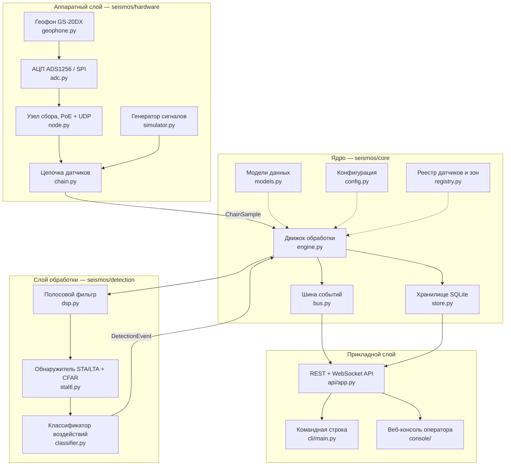

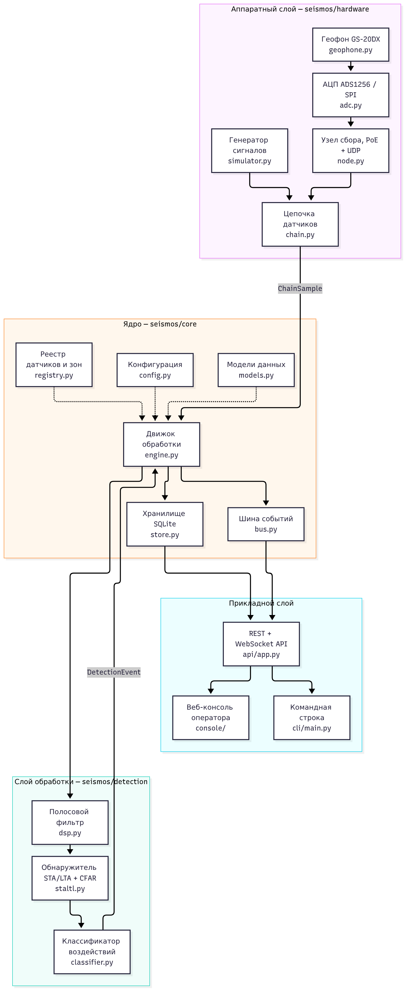


## 2. Поток данных

Путь от физического воздействия на грунт до тревоги на посту оператора.

```mermaid
flowchart LR
    A["Воздействие<br/>шаги, техника, подкоп"] --> B["Геофон GS-20DX<br/>напряжение, В"]
    B --> C["АЦП ADS1256<br/>24 бита, SPI"]
    C --> D["Нормировка<br/>В → мкм/с"]
    D --> E["Узел сбора<br/>пакет UDP, PoE"]
    E --> F["ChainReader<br/>ChainSample"]
    F --> G["ProcessingEngine.ingest"]
    G --> H["SeismicDetector.process"]
    H --> I["Classifier.classify"]
    I --> J["DetectionEvent"]
    J --> K["EventStore<br/>SQLite"]
    J --> L["EventBus.publish"]
    L --> M["WebSocket /ws"]
    M --> N["Консоль оператора"]
    J -->|уровень ≥ ТРЕВОГА<br/>и зона под охраной| O["Alarm"]
    O --> K
    O --> L
```

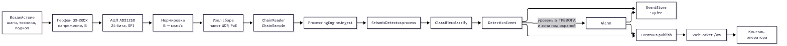


### Единица данных — `ChainSample`

`ChainSample` — блок отсчётов одного датчика (скорость грунта, мкм/с) с
меткой времени и порядковым номером. Движок принимает именно эти объекты,
поэтому источником может быть как реальный узел сбора, так и генератор
синтетических сигналов.

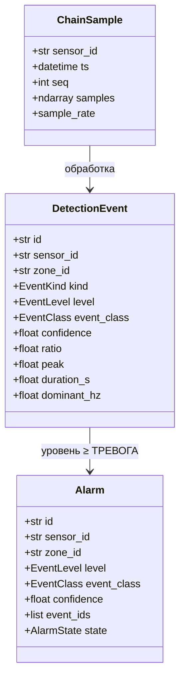

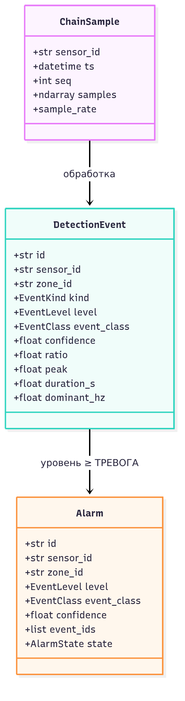


## 3. Алгоритм обнаружения события

Основной конвейер обработки одного канала геофона. Реализация —
`SeismicDetector.process()`.

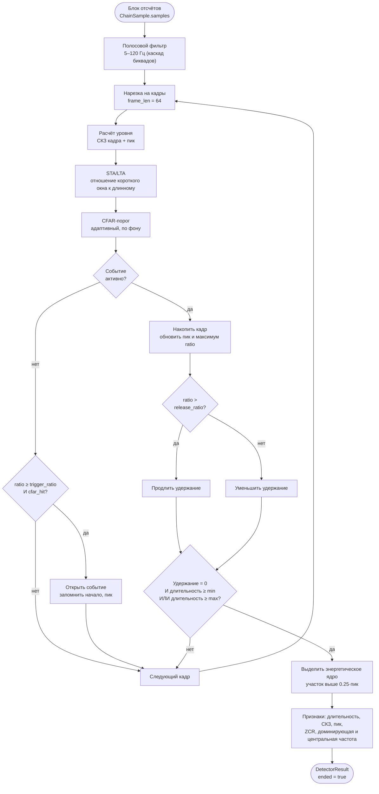

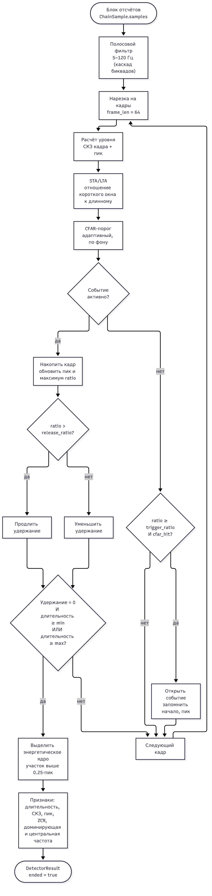


## 4. Классификация и уровни

Классификатор по вектору признаков определяет класс воздействия, класс
отображается в уровень значимости события (`CLASS_LEVEL`).

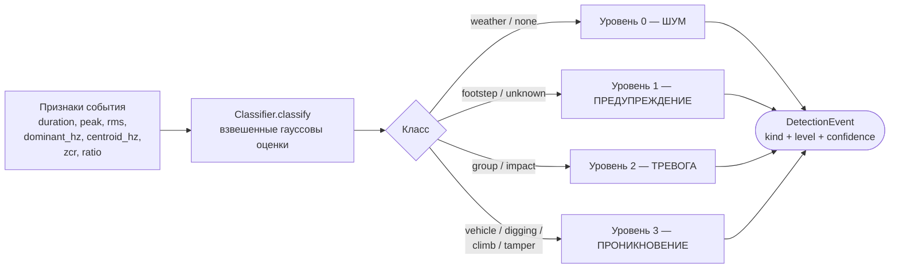

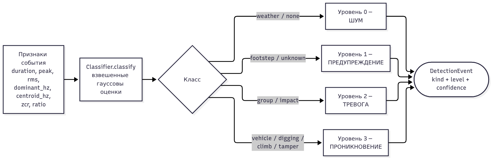


| Класс воздействия | Код | Уровень |
|---|---|---|
| Метео, шум | `weather`, `none` | 0 — ШУМ |
| Шаги, неизвестное | `footstep`, `unknown` | 1 — ПРЕДУПРЕЖДЕНИЕ |
| Группа людей, удар | `group`, `impact` | 2 — ТРЕВОГА |
| Техника, подкоп, перелаз, вскрытие | `vehicle`, `digging`, `climb`, `tamper` | 3 — ПРОНИКНОВЕНИЕ |

## 5. Конечный автомат состояний системы

Режимы работы системы (`SystemState`) и переходы между ними.

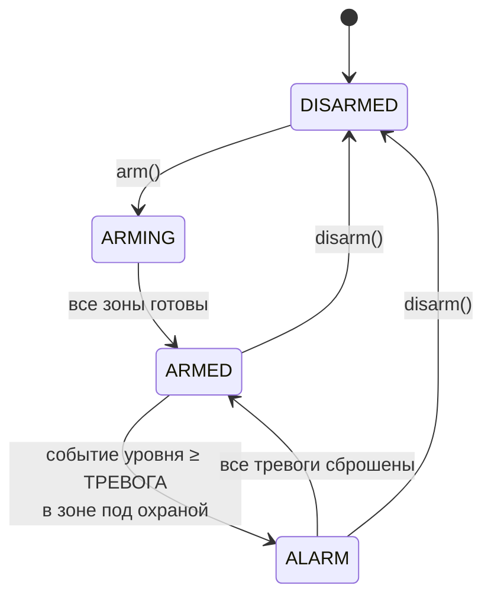

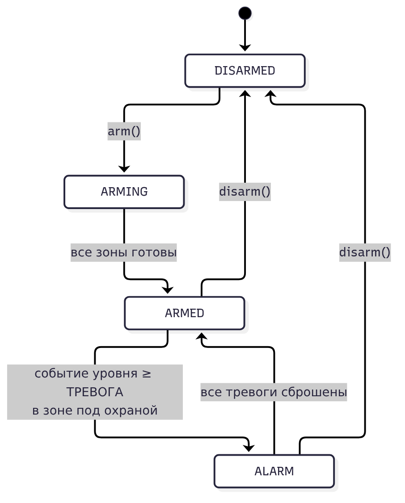


| Состояние | Описание |
|---|---|
| `disarmed` | Система снята с охраны, события только пишутся в журнал |
| `arming` | Переход к охране (проверка готовности датчиков) |
| `armed` | Система на охране, тревоги формируются |
| `alarm` | Зафиксирована тревога, требуется реакция оператора |

## 6. Жизненный цикл тревоги

Тревога формируется движком при событии уровня ≥ ТРЕВОГА в зоне под охраной
(`AlarmState`).

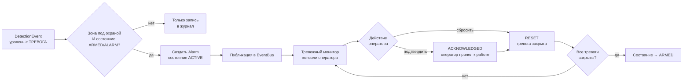

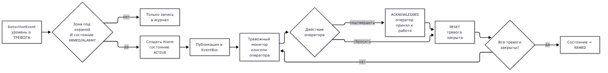


## 7. Схема развёртывания

Варианты запуска системы: локально, в Docker и под systemd.

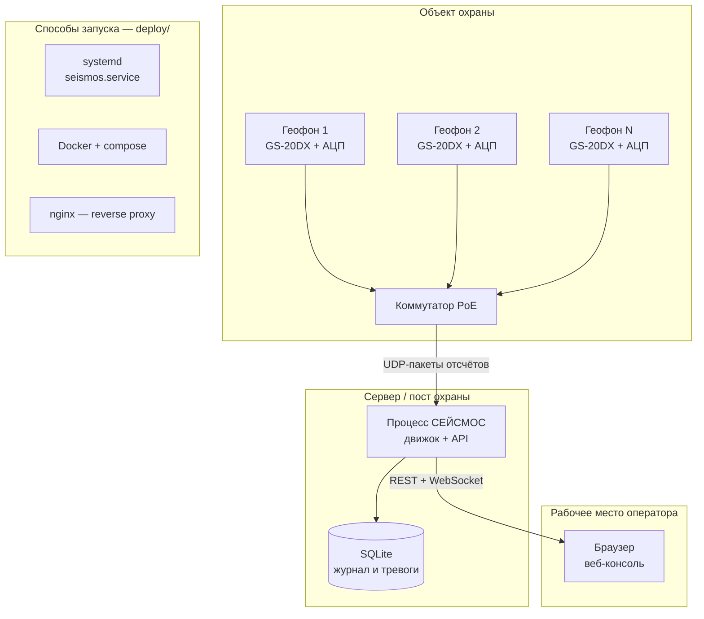

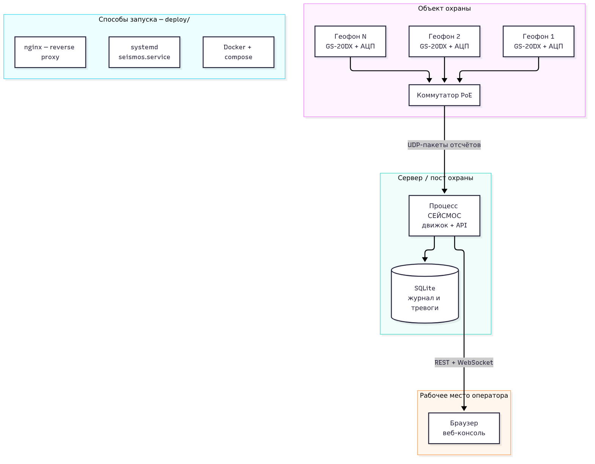


## 8. Аппаратный сегмент и цепочка датчиков

Датчики подключаются последовательно (цепочкой); `ChainReader` опрашивает их
по очереди и выдаёт блоки `ChainSample` движку.

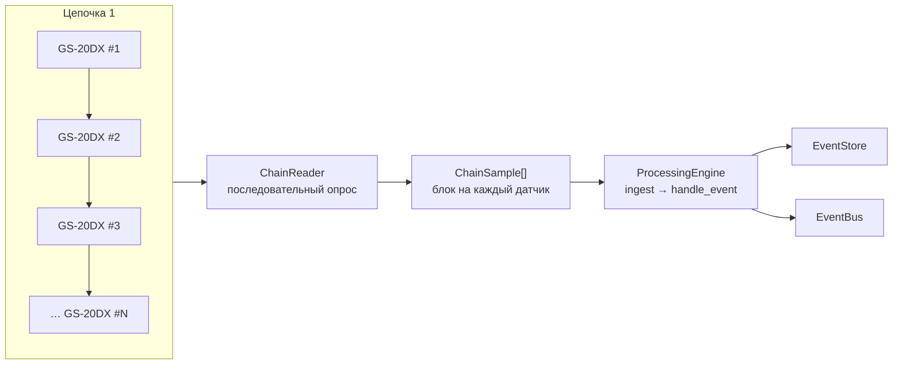

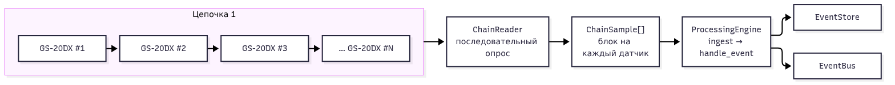


| Узел | Назначение |
|---|---|
| Геофон GS-20DX | Преобразование колебаний грунта в напряжение |
| АЦП ADS1256 | 24-битная оцифровка, интерфейс SPI |
| Узел сбора | Питание PoE, упаковка отсчётов в UDP-пакеты |
| `ChainReader` | Последовательный опрос цепочки датчиков |
| `ProcessingEngine` | Приём `ChainSample`, обнаружение, тревоги |

---

## Как пересобрать изображения

Исходные тексты схем — в этом файле. Для экспорта в SVG/PNG:

```bash
# Один раз: установить mermaid-cli
npx -y @mermaid-js/mermaid-cli --version

# Экспорт отдельной схемы (пример)
npx -y @mermaid-js/mermaid-cli -i docs/DIAGRAM.md -o docs/img/diagram.png
```

Схемы также отображаются автоматически при просмотре этого файла на GitHub.
